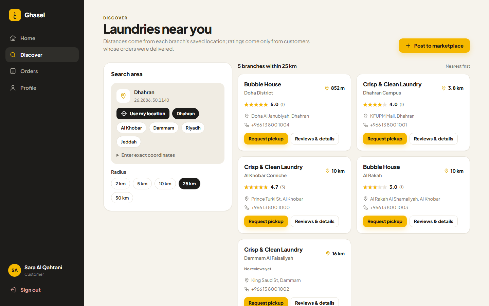
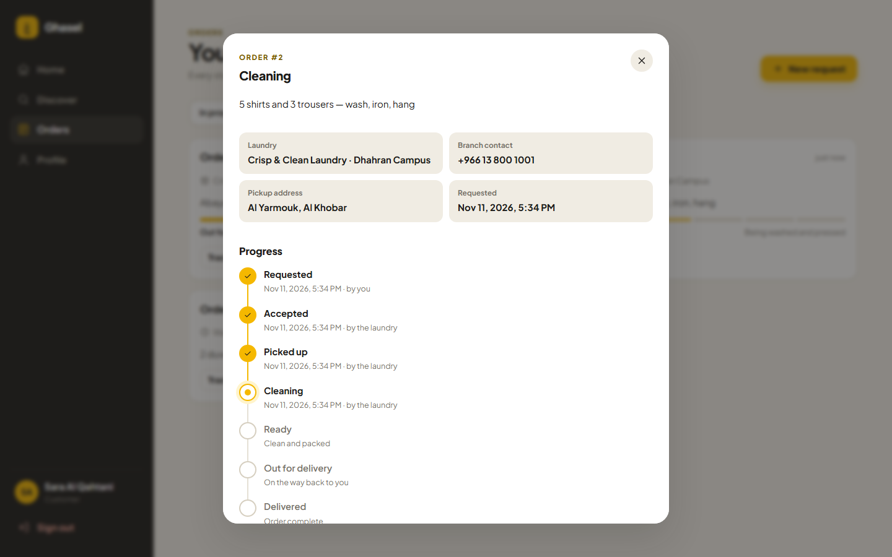
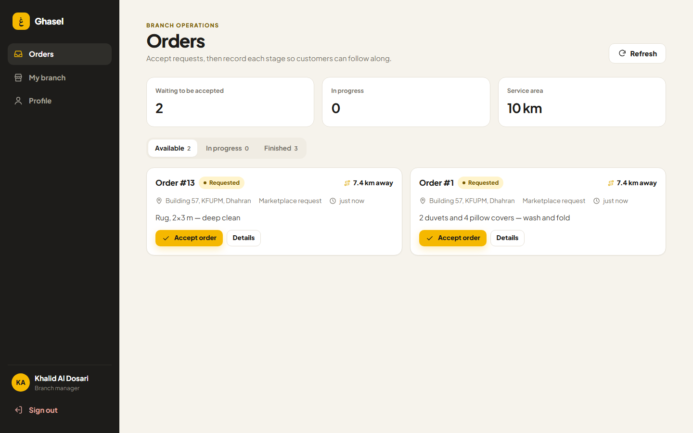
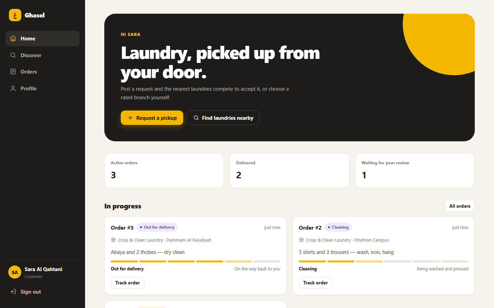
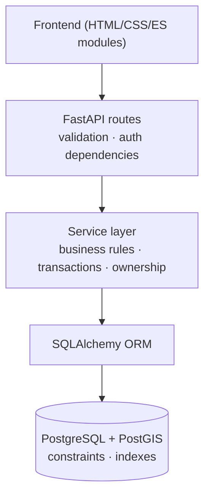

# Ghasel — On-Demand Laundry Marketplace

Customers post a laundry pickup request, and nearby laundry branches compete to accept it.


## Overview

Finding a laundry usually means calling around or settling for the nearest shop. Ghasel
turns that into a small marketplace:

- **Customers** post a request with a pickup point. Every laundry branch whose service area
  covers that point can see it, and the first to accept gets the order. Customers can also
  browse nearby branches by distance and rating and request one directly.
- **Laundry businesses** run several physical branches. Each branch has managers who accept
  orders and record every stage, from pickup to delivery.
- **Administrators** approve laundry businesses before they join the marketplace.

## Demo & screenshots

| Nearby discovery | Order tracking |
|---|---|
|  |  |
| **Branch operations** | **Customer dashboard** |
|  |  |

<sub>The screenshots use the demo dataset from `scripts/seed_demo.py`. A public deployment is planned.</sub>

## Engineering highlights

- **Concurrency-safe order acceptance.** Many branches can try to accept the same request
  at once; exactly one succeeds. Each acceptance is a single conditional `UPDATE ... WHERE
  status = 'PENDING'`, which PostgreSQL serialises with a row lock. Branch eligibility is
  re-checked inside that same statement. Tested with 12 concurrent threads and a
  deterministic interleaving test.
- **PostGIS nearby discovery.** Branches inside a radius, nearest first, with real
  distances. The search uses `ST_DWithin` / `ST_Distance` on a GiST-indexed `geography`
  column. With 100,000 branches it takes 0.21 ms with the index and 324 ms without it
  ([measurements](docs/performance.md)).
- **Enforced order lifecycle with history.** Status changes go through one transition table
  that defines who may make each change. Every change is written to an append-only history
  in the same transaction, and the tracking timeline is built from that history.
- **Database-level integrity.** CHECK constraints, unique constraints and generated
  columns back up the application rules. For example, an order can't leave `pending`
  without a branch, and an order can have only one review.

## Key features

| Customer | Laundry owner & branch manager | Admin |
|---|---|---|
| Search branches by location and radius | Apply for approval, add branches and managers | Approve laundry applications |
| Post marketplace or direct requests | Set each branch's location and service radius | View accounts |
| Track each stage on a timeline | See available orders, nearest pickup first | |
| Cancel before pickup | Accept orders and advance their stages | |
| Rate delivered orders | Read the branch's reviews and rating | |

## Architecture

Ghasel is a layered monolith. HTTP handling, business rules and persistence are kept apart.



- **Routes** are thin: they parse input, resolve the caller and call one service.
- **Services** own the rules: ownership checks, lifecycle transitions and transactions.
- **The database** enforces the invariants that must hold however it is accessed.

The architecture deliberately avoids extra layers and separate services until the problem
calls for them. The reasoning is in the [design document](docs/design-decisions.md).

## Tech stack

| Area | Tools |
|---|---|
| Backend | Python, FastAPI, Pydantic 2, JWT (PyJWT), Argon2 password hashing (pwdlib) |
| Database | PostgreSQL, PostGIS, SQLAlchemy 2, GeoAlchemy2, Alembic |
| Frontend | HTML, CSS, native JavaScript ES modules (no build step) |
| Quality | pytest (against a real PostgreSQL database), ruff |

## Getting started

**Prerequisites:** Python 3.12+ and PostgreSQL 15+ with the PostGIS 3 extension. On
Windows, install PostGIS with Stack Builder → Spatial Extensions.

```powershell
python -m venv .venv
.\.venv\Scripts\python.exe -m pip install -r requirements.txt
copy .env.example .env                 # set DATABASE_URL and SECRET_KEY
.\.venv\Scripts\alembic upgrade head   # build the schema
```

Start the API and the frontend in two terminals:

```powershell
.\.venv\Scripts\python.exe -m uvicorn app.main:app --reload
.\.venv\Scripts\python.exe -m http.server 5500 --directory .\frontend
```

Then open http://127.0.0.1:5500.

**Demo data.** `python -m scripts.seed_demo` builds a separate `<database>_demo` database
with sample businesses, branches, orders and reviews; it never touches your own database.
Point `DATABASE_URL` at it and sign in as `sara@ghasel.demo` (customer), `dana@ghasel.demo`
(manager), `hassan@ghasel.demo` (owner) or `admin@ghasel.demo`. The password for all of
them is `demo-password`.

## API documentation

FastAPI serves interactive OpenAPI docs at **http://127.0.0.1:8000/docs**.

| Group | Endpoints |
|---|---|
| Auth | `POST /auth/register`, `POST /auth/login` |
| Users | `GET/PATCH /users/me`, admin listing |
| Branches | `GET /branches/nearby`, `GET/PATCH /branches/{id}`, `GET /branches/{id}/reviews` |
| Orders | `POST /orders/`, `GET /orders/`, `GET /orders/available`, `GET /orders/{id}`, `POST /orders/{id}/accept`, `POST /orders/{id}/cancel`, `PATCH /orders/{id}/status` |
| Reviews | `POST /orders/{id}/review` |
| Laundries | applications, approval, branches and managers under `/laundries` |

## Testing

```powershell
.\.venv\Scripts\python.exe -m pytest
.\.venv\Scripts\ruff check app tests scripts alembic
```

The suite builds a throwaway test database from the migrations and refuses to run against
any database whose name doesn't contain "test". It verifies:

- authentication, role guards and resource ownership;
- every allowed and rejected order transition;
- concurrent acceptance and concurrent duplicate reviews;
- radius boundaries, distance ordering and invalid coordinates;
- review eligibility and rating aggregation;
- database constraints;
- a full migration upgrade → downgrade → upgrade round trip, compared against the models.

## Documentation & design decisions

- [Design decisions & tradeoffs](docs/design-decisions.md): architecture, data model,
  authorization, the order lifecycle, and how the design evolved
- [Spatial query performance](docs/performance.md): `EXPLAIN ANALYZE` method, results and caveats
- [Frontend structure](frontend/README.md)

## Limitations & future improvements

- **Not yet deployed.** The next milestone is Docker, CI with GitHub Actions, and a public demo.
- **No live GPS.** Tracking shows the stages the laundry records.
- **No address lookup.** Locations come from the browser, a city preset or typed coordinates.
- **Not built yet:** notifications, payments, refresh tokens and rate limiting.
- **Token storage.** The access token is kept in `localStorage`.
