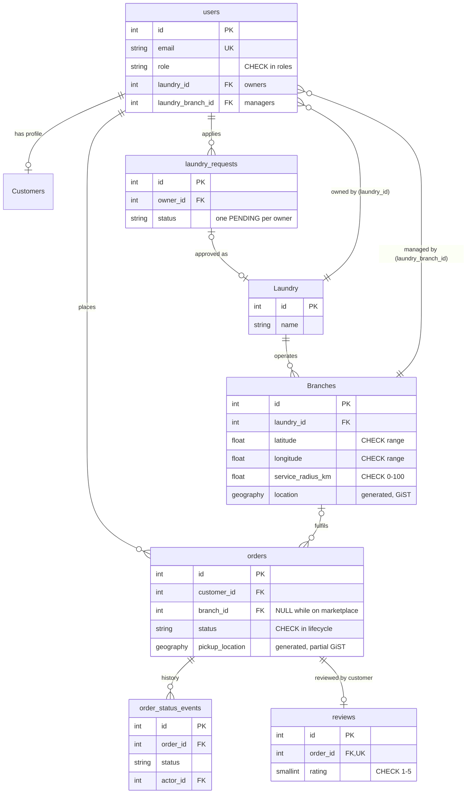

# Ghasel — Architecture & Design Decisions

This document explains why Ghasel is built the way it is: the decisions, the alternatives
considered, and the tradeoffs accepted. For a project overview and setup instructions, see
the [README](../README.md).

**Contents**

- [Architecture & design decisions](#architecture--design-decisions) (1–7)
- [Implementation decisions](#implementation-decisions) (8–12)
- [Data model](#data-model)
- [Engineering evolution & tradeoffs](#engineering-evolution--tradeoffs)

---

## Architecture & Design Decisions

Ghasel began as a small backend project centered on three entities: customers, laundries,
and laundry requests. As the requirements became clearer, the design evolved to support
shared authentication, multi-branch laundry businesses, resource-level authorization, and a
request-based marketplace.

The architecture follows a simple principle: **introduce complexity when the domain or a
concrete engineering problem justifies it, rather than implementing abstractions for their
own sake.**

### 1. Unified authentication with role-specific profiles

**Decision:** Use a shared `users` table for authentication and separate entities for
role-specific information.

The initial database design treated customers and laundries as independent entities.
However, authentication involves information and behavior shared by every type of user:
credentials, identity, and role.

Maintaining separate authentication implementations would duplicate responsibilities and
complicate authorization.

The design therefore separates:

- **User identity:** Authentication credentials, account information, and role (`users`).
- **Customer profile:** Information specific to customers, such as phone and default address (`Customers`).
- **Laundry business:** The company and its ownership (`Laundry`).
- **Branch management:** Users authorized to operate individual laundry branches (`users.laundry_branch_id`).

This keeps authentication centralized while preserving the distinct responsibilities of
each domain entity.

**Tradeoff:** Some operations need extra relationships or joins to retrieve role-specific
information. This was preferred over duplicating authentication logic across several user
tables.

### 2. Separating laundry companies from physical branches

**Decision:** Model a laundry business and its branches as distinct entities.

The original design assumed that each laundry was a single physical location. That
assumption became restrictive for businesses operating multiple branches.

A laundry company and a physical branch have different responsibilities:

- A laundry company represents the business and its ownership.
- A branch represents an operational location that can receive and fulfill orders. It has
  its own address, coordinates and service radius.
- Branch managers are associated with the branches they are authorized to operate.

This separation lets a company manage multiple locations without duplicating its business
identity. It also gives a clear ownership hierarchy for authorization and order management.

**Tradeoff:** The design adds relationships and authorization checks. However, the
distinction reflects a real requirement of the marketplace rather than speculative
architectural complexity.

### 3. Layered architecture and separation of concerns

**Decision:** Organize the backend around API routes, a service layer, and SQLAlchemy-based
persistence.

Ghasel uses a straightforward layered architecture:

```text
HTTP Request
     |
     v
FastAPI Router
     |
     v
Service / Business Logic
     |
     v
SQLAlchemy
     |
     v
PostgreSQL + PostGIS
```

Each layer has a defined responsibility.

- **API routes** handle HTTP concerns, request and response contracts, and dependency
  integration.
- **Services** coordinate application operations and enforce business rules.
- **SQLAlchemy and PostgreSQL** handle persistence, relationships, database constraints, and
  transactional data operations.

This separation keeps business behavior from becoming tightly coupled to HTTP endpoints. It
also makes individual workflows easier to inspect, test, and change.

In the codebase:

| Package | Responsibility |
|---|---|
| `app/routes/` | Thin FastAPI handlers: parse input, resolve the caller, call one service |
| `app/services/` | Business rules and transaction boundaries (orders, branches, reviews, laundry, users, auth) |
| `app/core/` | Settings, auth dependencies, domain errors, enums, the order state machine |
| `app/schemas/` | Pydantic request/response contracts and shared field constraints |
| `app/models/` | SQLAlchemy models |
| `app/db/` | Engine, session and PostGIS helpers |
| `alembic/` | Migration history: the source of truth for the schema |
| `frontend/` | Static single-page app; all data comes from the API |

#### Why not add more layers?

An earlier option put separate handlers between routes and services. A dedicated
repository layer was also considered.

Both were deliberately left out. For Ghasel's scope, they would have added indirection
without a sufficiently distinct responsibility. SQLAlchemy already provides a substantial
persistence abstraction, and the service layer is a clear home for application logic.

The architecture can evolve if data-access complexity or testing requirements justify
more boundaries.

**Tradeoff:** Services remain coupled to SQLAlchemy. That was accepted in exchange for a
smaller and more understandable codebase.

### 4. Authentication, authorization, and resource ownership

**Decision:** Separate identity verification, role-based permissions, and resource-level
access control.

Authentication answers who is making a request. Authorization determines what that user is
allowed to do.

Role-based authorization alone is not enough for a multi-branch marketplace. Being
authenticated as a branch manager, for example, must not grant permission to modify orders
belonging to another branch.

Ghasel therefore distinguishes three concerns:

- **Authentication:** Validate the user's JWT and resolve the authenticated account.
- **Role authorization:** Restrict operations according to the user's role.
- **Resource ownership:** Verify that the user is associated with the specific company,
  branch, or order involved in the operation.

Reusable FastAPI dependencies (`require_roles`, `OwnedLaundry`) enforce access requirements
at the API boundary. Business-critical ownership rules live in the service layer, and for
order transitions inside the SQL statement itself. They therefore hold no matter which
route or script invokes the operation.

Ownership is always derived from the authenticated user, never from client-supplied IDs.
When a user asks for a private resource they don't own, such as another customer's order or
another company, Ghasel returns `404` rather than `403`, so IDs belonging to other accounts
can't be probed.

**Tradeoff:** Authorization adds database lookups and dependencies. These checks protect
resources and can't be removed merely to reduce query count.

### 5. Domain-driven database modeling without unnecessary complexity

**Decision:** Model entities according to their actual responsibilities and lifecycles,
rather than creating a table for every conceptual role.

Several possible database structures were reconsidered during development.

One was whether branch managers needed their own table. Managers are authenticated users
associated with a branch, so a separate manager entity wasn't justified. They are users
with the `manager` role and a `laundry_branch_id`.

Another concerned laundry registration and approval. Here a separate entity *is* justified:
an application (`laundry_requests`) exists before any approved business does, and it has its
own lifecycle (`pending → approved / rejected`).

The deciding factor is whether a proposed table represents a genuinely distinct concept
with its own data and lifecycle.

This approach aims to preserve relational integrity while avoiding unnecessary entities and
duplicated state.

**Tradeoff:** A smaller schema can require careful handling of roles, optional
relationships, and lifecycle states. But adding more tables doesn't inherently make the
domain model clearer.

### 6. Database correctness over minimizing query count

**Decision:** Judge database queries on correctness, clarity, and measured performance,
rather than assuming fewer queries are always better.

Some service operations need several lookups to validate ownership, retrieve related
entities, or enforce business rules.

Reducing unnecessary round trips is desirable. But combining several queries into one
complex statement is not automatically an improvement.

Database access decisions should consider:

- Whether a lookup is redundant.
- Whether relationships can be loaded more efficiently.
- Whether an N+1 query pattern exists.
- Whether appropriate indexes support the query.
- Whether combining operations changes transaction or locking behavior.
- Whether measurements demonstrate a meaningful performance benefit.

For transactional operations, correctness takes priority over reducing the number of SQL
statements. Index decisions are backed by `EXPLAIN ANALYZE` measurements rather than
assumptions ([spatial query performance](performance.md)).

### 7. Explicit order lifecycle and business invariants

**Decision:** Treat order status changes as controlled business operations, not unrestricted
updates to a database column.

An order represents a process involving a customer and a laundry branch. Its status
determines which actions are valid and who may perform them, so an order must not move
arbitrarily between states.

A database column can store a status value, but the application defines what that status
means and how it may change. The application therefore enforces valid transitions,
authorization requirements, and ownership restrictions.

The marketplace model also raises a concurrency concern: several branches may try to accept
the same request at the same moment. Making sure an order can't be assigned to more than one
branch is a database correctness requirement, not merely an API validation concern. How this
is guaranteed is described in [decision 8](#8-atomic-acceptance-as-a-compare-and-set).

---

## Implementation decisions

The decisions above shaped the domain. The ones below concern how specific guarantees are
implemented.

### 8. Atomic acceptance as a compare-and-set

**Decision:** Apply every status change as a single conditional `UPDATE`, rather than reading
the order, checking it in Python, and writing it back.

```text
PENDING ──accept──▶ ACCEPTED ─▶ PICKED_UP ─▶ CLEANING ─▶ READY ─▶ DELIVERING ─▶ COMPLETED
   │                   │
   └─cancel (customer) └─cancel (customer or branch, before pickup)
```

The transition rules live in one table, `app/core/order_lifecycle.py`. For each transition it
lists the source and target status, the actors allowed to make it, and the timestamp it sets.
The service turns a permitted transition into a statement like:

```sql
UPDATE orders
SET status = 'ACCEPTED', branch_id = :branch, accepted_at = now()
WHERE id = :id
  AND status = 'PENDING'
  AND (branch_id = :branch
       OR (branch_id IS NULL AND ST_DWithin(pickup_location, <branch location>, <service radius>)))
RETURNING id
```

PostgreSQL locks the row for the first writer. Concurrent writers wait, then re-evaluate the
`WHERE` clause once the first one commits. They find the order is no longer `PENDING`, match
zero rows, and receive `409 Conflict`. The eligibility condition sits inside the statement,
so a branch acting on a stale read still can't take an order it isn't allowed to take.

**Alternatives considered:**

- *Application-level check then write.* This is racy: two requests can both read `PENDING`
  before either writes.
- *`SELECT ... FOR UPDATE`, then update.* This is correct, but it needs two statements and a
  longer-held lock for no added guarantee.
- *Optimistic version column.* This works too, but the status column already serves as the
  version.

**Verification:** One test runs 12 threads, each with its own database transaction, against
one order and asserts that exactly one wins and exactly one `accepted` history event exists.
A deterministic test holds a row lock while a competing acceptance blocks, commits, and then
asserts that the blocked request loses. Removing the status condition makes both tests fail.

### 9. Status history written in the same transaction

**Decision:** Record every status an order enters in an append-only `order_status_events`
table. Each event is inserted in the same transaction as the status change.

The tracking timeline in the UI is built from this history, so it shows what actually
happened, with times and who made each change. Because the event and the change commit
together, a rejected or losing transition leaves no trace, and the history can't disagree
with the order's current status. Milestone timestamps (`accepted_at`, `completed_at`,
`cancelled_at`) are kept on the order for simple queries.

**Tradeoff:** An extra table and an extra insert per transition. These were accepted because
honest tracking was a product requirement.

### 10. Spatial data: coordinates as truth, geography as a generated column

**Decision:** Store latitude and longitude as validated columns. Derive a PostGIS
`geography(Point, 4326)` column from them as a `STORED` generated column, and index it with
GiST.

- `CHECK` constraints enforce valid ranges, and that latitude and longitude are both set or
  both missing.
- Because the geography column is generated, it can never disagree with the coordinates.
- `geography` measures distances in metres on the spheroid, which avoids degree-based
  approximations.
- Branches without a location are excluded from nearby search and from marketplace
  matching, rather than causing errors.

Distance filtering and sorting happen in PostgreSQL with `ST_DWithin` and `ST_Distance`.
Ghasel never loads every branch into Python to compute distances.

Measured with 100,000 synthetic branches, a 5 km search takes 0.21 ms with the GiST index
and 324 ms without it. The method and caveats are in [performance.md](performance.md).

### 11. Reviews reference only the order

**Decision:** A review stores `order_id` (unique), `rating` and `comment`. The branch and the
customer are read through the order.

Storing `branch_id` and `customer_id` on the review would duplicate state that could drift
from the order. Instead, the unique constraint enforces one review per order, even under
concurrent submissions. The service checks that the reviewer owns the order and that the
order is `COMPLETED`. Because `COMPLETED` is a terminal status, that check can't be
invalidated by a concurrent change. Branch ratings are aggregated with `AVG` and `COUNT`
when read, rather than stored.

**Tradeoff:** Rating queries join through `orders`. At Ghasel's scale that join uses existing
indexes. A stored, denormalized rating would only be worth its consistency cost if
measurements showed a need.

### 12. Domain errors, validation and migrations

- **Domain errors.** Services raise `NotFoundError`, `ConflictError`,
  `PermissionDeniedError` and similar errors, and a single exception handler maps them to
  HTTP responses. Business logic therefore doesn't depend on FastAPI, and every endpoint
  reports errors consistently.
- **Validation at the edge, invariants in the database.** Pydantic validates input:
  non-finite coordinates, password length, rating range and so on. The database then
  enforces what must always hold through `CHECK` and unique constraints and foreign keys.
- **Alembic as the schema's source of truth.** The existing database was brought under
  Alembic in two steps. A baseline revision matching the old schema was applied with
  `stamp` only, without running it. A follow-up revision then repaired the drift: it
  created the missing `laundry_requests` table, normalised legacy role values, and converted
  timestamps to `timestamptz`, all without deleting data. A test replays the whole history
  (upgrade → downgrade → upgrade) and checks that the result matches the models.

---

## Data model



Key invariants enforced by the database:

| Invariant | Mechanism |
|---|---|
| An order has a branch once it leaves `pending` (unless cancelled) | `ck_orders_branch_assigned` |
| A marketplace order has a pickup point | `ck_orders_marketplace_has_pickup` |
| Status values are valid lifecycle states | `ck_orders_status`, `ck_order_status_events_status` |
| One review per order; rating 1–5 | `uq_reviews_order`, `ck_reviews_rating` |
| One pending laundry application per owner | partial unique index `uq_laundry_requests_one_pending_per_owner` |
| Coordinates in range and paired | `ck_branches_*`, `ck_orders_pickup_*` |

Indexes follow the actual query patterns:

- customer and branch order feeds: `(customer_id, created_at DESC)` and `(branch_id, created_at DESC)`;
- spatial search: GiST on `Branches.location`;
- marketplace matching: a partial GiST on `orders.pickup_location` where `status = 'PENDING' AND branch_id IS NULL`;
- tracking history: `(order_id, created_at)`.

---

## Engineering Evolution & Tradeoffs

### From a simple CRUD application to a marketplace domain

Ghasel's initial scope was deliberately small: register users, manage laundries, create
orders, and update their statuses.

The design evolved as limitations became apparent.

| Initial approach | Design evolution | Reason |
|---|---|---|
| Separate customer and laundry identities | Unified user authentication | Reduce duplicated identity and authentication responsibilities |
| One laundry represents one location | Laundry companies with branches | Support businesses operating multiple locations |
| Role checks alone | Role and resource ownership checks | Prevent cross-branch and cross-account access |
| Routes and handlers as separate layers | Routes coordinating directly with services | Avoid unnecessary indirection |
| Additional tables for each operational role | Reuse users and explicit relationships where appropriate | Avoid redundant entities and state |
| Direct order assignment to a branch | Free-market ordering, with direct requests still supported | Let eligible nearby branches discover and accept requests |
| Simple status updates | Explicit lifecycle rules with recorded history | Protect valid business transitions and support honest tracking |
| Read, check, then write | Single conditional `UPDATE` | Make concurrent acceptance safe at the database level |
| Hand-applied SQL scripts | Alembic migrations | Make the schema reproducible and repair drift without losing data |

These changes came from a clearer understanding of the product and its constraints, not from
an attempt to adopt a particular architectural pattern.

### Keeping the architecture proportional to the problem

Ghasel is a single backend application, not a collection of microservices.

This avoids distributed communication, service discovery, independently deployed
components, and the operational overhead that comes with them, before the product needs any
of it.

The same principle applies within the codebase: abstractions are introduced when they
clarify responsibilities, protect important invariants, or make demonstrated changes easier.

The goal is not to maximize architectural sophistication. It is to keep the system
understandable while allowing it to evolve.

### Lessons from iterative development

Several recurring engineering considerations shaped the project's evolution:

- **Domain modeling comes before database structure.** Understanding the difference between
  a company, a branch, a manager, and an order determines which relationships belong in the
  schema.
- **Correctness is not the same as successful execution.** An endpoint returning a
  successful response doesn't prove that ownership rules, concurrency guarantees, or
  transactional invariants hold. Those need tests designed to break them.
- **Abstractions have costs.** Additional layers and entities can improve separation, but
  they also increase the code and reasoning needed to understand a workflow.
- **Performance should be investigated, not assumed.** Query counts, indexing decisions,
  and ORM loading strategies need to be evaluated against actual query patterns and
  database behavior.
- **Architecture evolves with requirements.** A design can suit an earlier version of the
  application and need to change when the domain becomes more complex.

These principles continue to guide Ghasel's development as new functionality is added.
